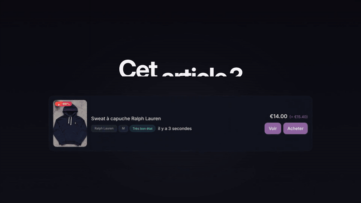
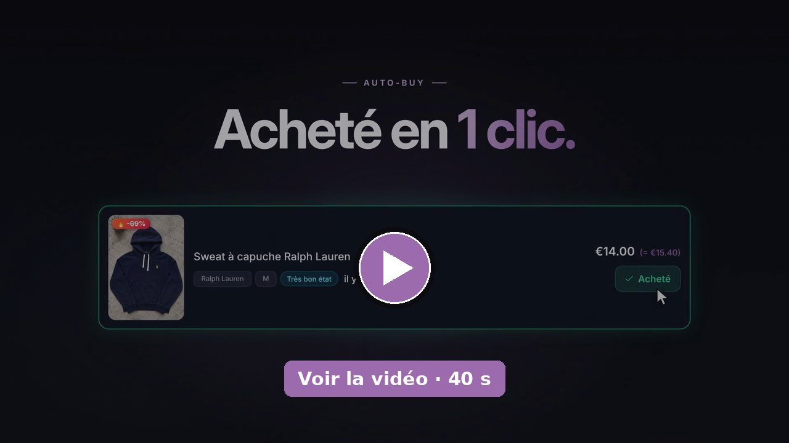
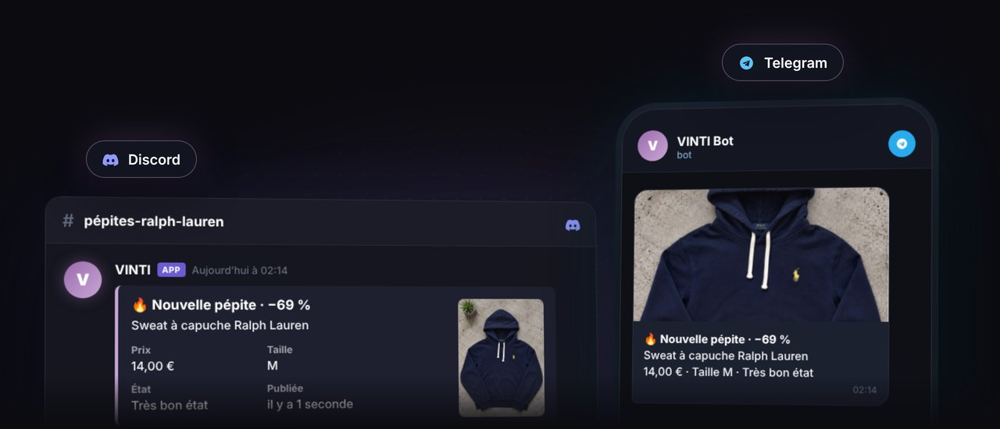
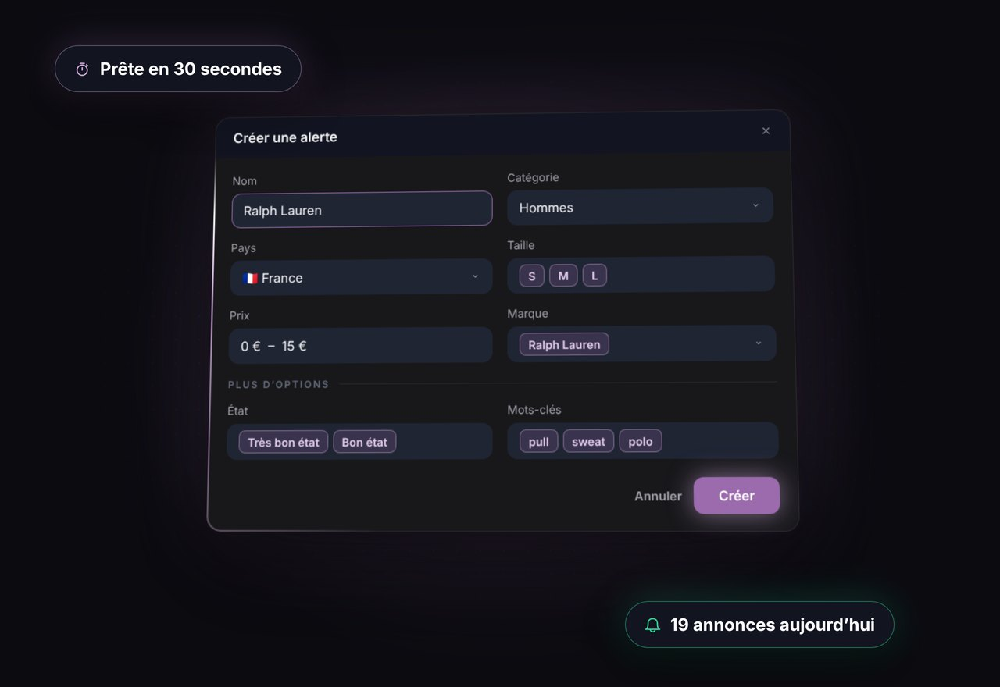
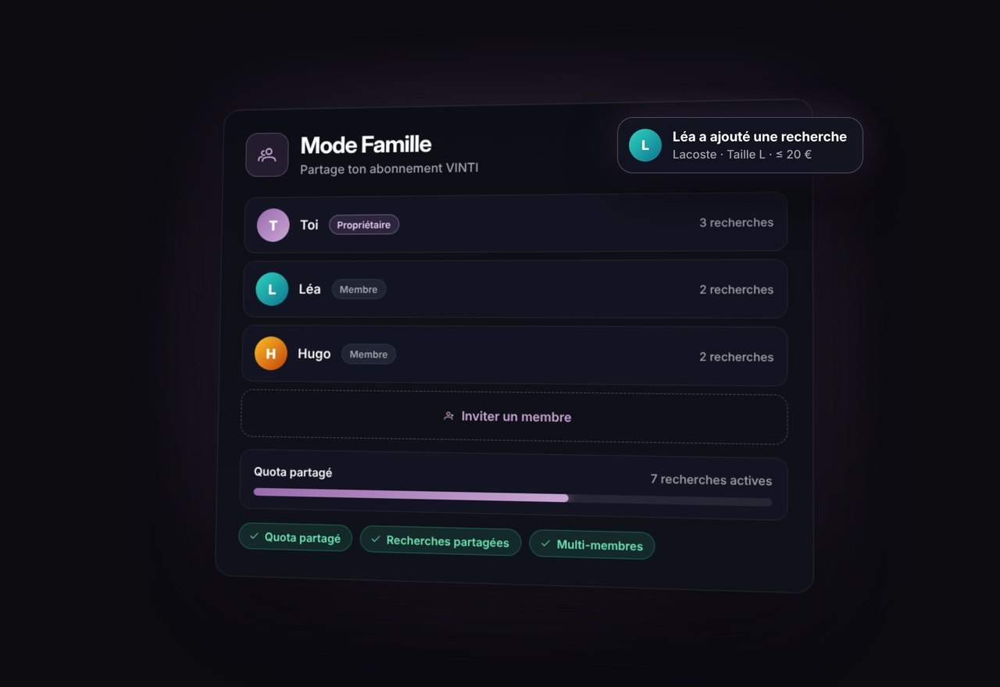
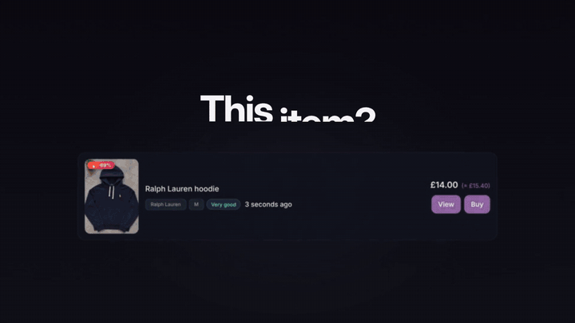
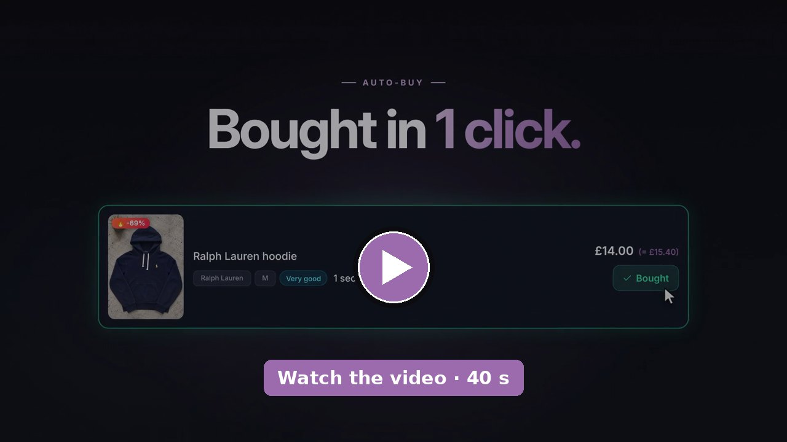

<a href="#francais">🇫🇷 Français</a> · <a href="#english">🇬🇧 English</a>

# VINTI — le bot Vinted

### Soyez le premier sur chaque bonne affaire Vinted.

*Pendant que les autres scrollent, vous achetez.*

**VINTI surveille Vinted 24h/24, vous alerte en quelques millisecondes et peut acheter à votre place.**

[**Voir les formules**](https://vintibot.com/fr#pricing)

---

## Ce que fait VINTI

1. **Il surveille Vinted pour vous, 24h/24, 7j/7**, selon les recherches que vous avez créées.
2. **Il vous alerte en quelques millisecondes**, dès la mise en ligne d'une annonce qui vous correspond.
3. **Il vous prévient où vous êtes** : dans l'app VINTI, en notification push, sur Discord ou sur Telegram.
4. **Il vous laisse acheter en 1 clic** grâce à l'Auto-Buy, directement depuis le Flux en temps réel.
5. **Il peut acheter à votre place** avec l'Auto-Cop : fixez vos critères une fois, VINTI achète les articles qui y correspondent, même pendant que vous dormez.
6. **Votre compte reste chez vous** : votre compte Vinted n'est utilisé que depuis l'app de bureau, sur votre propre connexion et à un rythme naturel — jamais depuis nos serveurs.

## La vidéo

Cliquez sur l'image pour lancer la vidéo (40 s).

## Pour qui ?

- **Les chineurs et passionnés de mode** — la pièce que vous cherchez depuis des semaines arrive enfin ? Vous êtes prévenu tout de suite.
- **Les familles et petits budgets** — vêtements enfants dans la bonne taille, au bon prix, sans passer vos soirées à faire défiler les annonces.
- **Les collectionneurs** — sneakers, vintage, marques prisées : soyez là avant que la pépite ne parte.
- **Les revendeurs et boutiques** — des recherches en continu, sur tous les pays Vinted, pour trouver le bon stock au bon prix.

## Fonctionnalités

### Flux en temps réel
Chaque annonce qui correspond à l'une de vos recherches apparaît aussitôt dans le « Fil d'actualités » de l'app VINTI, avec photo, prix, marque, taille et état.

### Alertes Discord & Telegram
Recevez vos trouvailles sur votre propre serveur Discord (webhook personnel, une alerte par recherche, avec le lien vers l'annonce) ou sur Telegram via votre propre bot, créé en 2 minutes avec @BotFather. Incluses dans toutes les formules, comme les notifications push sur navigateur et téléphone.

 Exemple illustratif.

### Auto-Buy : l'achat en 1 clic
Une annonce vous plaît ? Cliquez sur « Acheter » dans le Flux en temps réel : l'achat est passé par votre app de bureau VINTI, avec votre compte Vinted. Si votre banque demande une validation 3D Secure, VINTI vous l'affiche. Disponible à partir de la formule Plus.

### Auto-Cop : l'achat automatique 24h/24
Fixez vos critères une fois : VINTI achète automatiquement les articles qui y correspondent, même pendant que vous dormez. Disponible à partir de la formule Plus.

### Tous les pays Vinted, au choix par recherche
Pour chaque recherche, vous choisissez le pays Vinted à surveiller. Mots-clés, catégorie, marque, taille, état, couleur, matière, prix minimum et maximum, mots et vendeurs exclus, note minimale du vendeur : tout se règle dans « Mes filtres ». Vous pouvez aussi importer une URL de recherche Vinted.

 Exemple illustratif.

### Mode Famille
Avec la formule Professional, invitez vos proches par e-mail. Chaque membre a son propre espace et relie son propre compte Vinted.

 Exemple illustratif.

### L'app de bureau VINTI, sur Windows & Mac
Elle relie votre compte Vinted et passe vos achats depuis votre ordinateur. Elle continue de tourner en arrière-plan quand vous fermez la fenêtre.

## Formules

Prix TTC, par mois.

| | **Essential** | **Plus** | **Professional** |
|---|:---:|:---:|:---:|
| Prix | **9,99 €** | **39,99 €** | **79,99 €** |
| Pour qui | Pour démarrer et recevoir les bonnes affaires en direct | Le plus choisi : l'achat automatique en plus | Pour chercher sans limite, seul ou à plusieurs |
| Recherches simultanées | 10 | 30 | **Illimitées** |
| Flux en temps réel, filtres avancés, repérage des pépites | ✓ | ✓ | ✓ |
| Tous les pays Vinted | ✓ | ✓ | ✓ |
| Alertes Discord & Telegram, notifications navigateur et téléphone | ✓ | ✓ | ✓ |
| Achats depuis votre propre connexion, rythme naturel | ✓ | ✓ | ✓ |
| Auto-Buy (achat en 1 clic) | — | ✓ | ✓ |
| Auto-Cop (achat automatique 24h/24) | — | ✓ | ✓ |
| 3D Secure intégré, suivi des achats | — | ✓ | ✓ |
| Mode Famille, usage commercial | — | — | ✓ |
| Support | Discord | Discord | Prioritaire |

**Engagement de 3 mois** à la souscription. Résiliation possible à tout moment, prise en compte à la fin des 3 mois (frais de résiliation anticipée plafonnés à 50 € TTC) ; ensuite, résiliation libre avec un préavis de 14 jours. Paiement sécurisé par Shopify. Détail dans les [conditions générales](https://vintibot.com/policies/terms-of-service).

### Professional : alimentez votre propre communauté

Vous animez un serveur Discord ou un groupe Telegram ? Avec **Professional et ses recherches illimitées**, créez autant de recherches que nécessaire et envoyez chacune d'elles dans le salon de votre choix : sneakers, vintage, enfants, petits prix… Votre communauté reçoit les bonnes affaires dès leur mise en ligne, et vous lui proposez un vrai service d'alertes.

[**Choisir ma formule**](https://vintibot.com/fr#pricing)

## Sécurité de votre compte

> Votre compte Vinted n'est utilisé que depuis l'app de bureau, sur votre propre connexion et à un rythme naturel — jamais depuis nos serveurs.

En savoir plus : [l'architecture de VINTI](https://vintibot.com/fr/pages/bot-vinted-sans-ban).

## Questions fréquentes

**Comment démarrer ?**
Choisissez une formule sur [vintibot.com](https://vintibot.com/fr#pricing), créez votre mot de passe, installez l'app de bureau VINTI (Windows ou Mac), connectez-vous à Vinted pour relier votre compte, puis créez vos recherches dans « Mes filtres ».

**Quelle différence entre Auto-Buy et Auto-Cop ?**
L'Auto-Buy, c'est l'achat en 1 clic : vous voyez l'annonce, vous cliquez, c'est acheté. L'Auto-Cop achète à votre place, selon les critères que vous avez fixés, même la nuit. Les deux sont inclus à partir de la formule Plus. Les alertes Discord et Telegram, elles, ouvrent l'annonce sur Vinted.

**Dois-je laisser mon ordinateur allumé ?**
Pour une surveillance complète, l'Auto-Buy et l'Auto-Cop, oui : l'ordinateur doit rester allumé avec l'app de bureau lancée (elle tourne en arrière-plan quand vous fermez la fenêtre).

**Quels pays Vinted puis-je surveiller ?**
Tous les pays Vinted. Vous choisissez le pays pour chaque recherche.

**Puis-je résilier ?**
Oui. L'abonnement comporte un engagement de 3 mois ; une résiliation demandée pendant cette période prend effet à la fin des 3 mois. Ensuite, vous résiliez quand vous voulez, avec un préavis de 14 jours.

## Guides du blog

- [Alerte Vinted : recevoir une notification à chaque nouvelle annonce](https://vintibot.com/fr/blogs/guides/alerte-vinted-notification)
- [Astuces de recherche Vinted pour dénicher les pépites](https://vintibot.com/fr/blogs/guides/astuces-recherche-vinted)
- [Autocop Vinted, sniper ou Auto-Buy : lequel choisir ?](https://vintibot.com/fr/blogs/guides/autocop-auto-buy-vinted)
- [Souk ou VINTI : lequel choisir ?](https://vintibot.com/fr/blogs/guides/vinti-ou-souk)
- [Acheter sur Vinted à l'étranger : le guide](https://vintibot.com/fr/blogs/guides/acheter-vinted-etranger)
- [Habiller toute la famille sur Vinted à petit prix](https://vintibot.com/fr/blogs/guides/vinted-famille-petit-prix)
- [Recherche sauvegardée Vinted : pourquoi vous ne recevez pas les notifications](https://vintibot.com/fr/blogs/guides/recherche-sauvegardee-vinted-notification)

---

### Soyez le premier sur chaque bonne affaire Vinted.

[**Voir les formules sur vintibot.com**](https://vintibot.com/fr#pricing) · [Rejoindre le Discord](https://discord.gg/XtHueHB9hm) · contact@vintibot.com

[Conditions générales](https://vintibot.com/policies/terms-of-service) · [Confidentialité](https://vintibot.com/policies/privacy-policy) · © VINTI

 

---

 

# VINTI — the Vinted bot

### Be first on every Vinted deal.

*While others scroll, you buy.*

**VINTI watches Vinted 24/7, alerts you within milliseconds and can buy for you.**

[**See the plans**](https://vintibot.com/#pricing)

---

## What VINTI does

1. **It watches Vinted for you, 24/7**, based on the searches you create.
2. **It alerts you within milliseconds**, as soon as a matching listing goes live.
3. **It reaches you wherever you are**: in the VINTI app, by push notification, on Discord or on Telegram.
4. **It lets you buy in 1 click** with Auto-Buy, straight from the real-time feed.
5. **It can buy for you** with Auto-Cop: set your criteria once and VINTI buys the matching items, even while you sleep.
6. **Your account stays with you**: your Vinted account is only used from the desktop app, on your own connection and at a natural pace — never from our servers.

## The video

Click the image to play the video (40 s).

## Who is it for?

- **Thrifters and fashion lovers** — the piece you've been hunting for weeks finally shows up? You know right away.
- **Families and small budgets** — kids' clothes in the right size, at the right price, without spending your evenings scrolling.
- **Collectors** — sneakers, vintage, sought-after brands: be there before the gem is gone.
- **Resellers and shops** — searches running non-stop, across every Vinted country, to find the right stock at the right price.

## Features

### Real-time feed
Every listing that matches one of your searches appears instantly in the VINTI app feed, with photo, price, brand, size and condition.

### Discord & Telegram alerts
Get your finds on your own Discord server (personal webhook, one alert per search, with the link to the listing) or on Telegram through your own bot, created in 2 minutes with @BotFather. Included in every plan, along with browser and phone push notifications.

 Illustrative example (French interface).

### Auto-Buy: 1-click buying
Like a listing? Click "Buy" in the real-time feed: the purchase goes through your VINTI desktop app, with your own Vinted account. If your bank asks for 3D Secure, VINTI shows it to you. Available from the Plus plan.

### Auto-Cop: automatic buying 24/7
Set your criteria once: VINTI automatically buys the items that match, even while you sleep. Available from the Plus plan.

### Every Vinted country, chosen per search
For each search, you pick the Vinted country to watch. Keywords, category, brand, size, condition, colour, material, min and max price, excluded words and sellers, minimum seller rating: it's all in "My filters". You can also import a Vinted search URL.

 Illustrative example (French interface).

### Family Mode
With the Professional plan, invite your loved ones by email. Each member gets their own space and links their own Vinted account.

 Illustrative example (French interface).

### The VINTI desktop app, for Windows & Mac
It links your Vinted account and places your purchases from your computer. It keeps running in the background when you close the window.

## Plans

Prices include VAT, per month.

| | **Essential** | **Plus** | **Professional** |
|---|:---:|:---:|:---:|
| Price | **€9.99** | **€39.99** | **€79.99** |
| For | To get started and receive deals live | Most chosen: automatic buying on top | To search without limits, alone or together |
| Simultaneous searches | 10 | 30 | **Unlimited** |
| Real-time feed, advanced filters, deal spotting | ✓ | ✓ | ✓ |
| Every Vinted country | ✓ | ✓ | ✓ |
| Discord & Telegram alerts, browser and phone notifications | ✓ | ✓ | ✓ |
| Purchases from your own connection, natural pace | ✓ | ✓ | ✓ |
| Auto-Buy (1-click buying) | — | ✓ | ✓ |
| Auto-Cop (automatic buying 24/7) | — | ✓ | ✓ |
| Built-in 3D Secure, purchase tracking | — | ✓ | ✓ |
| Family Mode, commercial use | — | — | ✓ |
| Support | Discord | Discord | Priority |

**3-month commitment** when you subscribe. You can cancel at any time; cancellation takes effect at the end of the 3 months (early-termination fee capped at €50 incl. VAT). After that, cancel freely with 14 days' notice. Secure payment by Shopify. Details in the [terms of service](https://vintibot.com/policies/terms-of-service).

### Professional: power your own community

Running a Discord server or a Telegram group? With **Professional and its unlimited searches**, create as many searches as you need and send each one to the channel of your choice: sneakers, vintage, kids, bargains… Your community gets deals as soon as they go live, and you offer them a real alert service.

[**Choose my plan**](https://vintibot.com/#pricing)

## Your account's safety

> Your Vinted account is only used from the desktop app, on your own connection and at a natural pace — never from our servers.

Learn more: [how VINTI is built](https://vintibot.com/fr/pages/bot-vinted-sans-ban) (in French).

## FAQ

**How do I get started?**
Choose a plan on [vintibot.com](https://vintibot.com/#pricing), create your password, install the VINTI desktop app (Windows or Mac), log in to Vinted to link your account, then create your searches in "My filters".

**What's the difference between Auto-Buy and Auto-Cop?**
Auto-Buy is 1-click buying: you see the listing, you click, it's bought. Auto-Cop buys for you, based on the criteria you set, even at night. Both are included from the Plus plan. Discord and Telegram alerts open the listing on Vinted.

**Do I need to keep my computer on?**
For full monitoring, Auto-Buy and Auto-Cop, yes: your computer must stay on with the desktop app running (it keeps running in the background when you close the window).

**Which Vinted countries can I watch?**
Every Vinted country. You choose the country for each search.

**Can I cancel?**
Yes. Subscriptions come with a 3-month commitment; if you cancel during that period, it takes effect at the end of the 3 months. After that, cancel whenever you like with 14 days' notice.

## Guides

- [Vinted bot UK: see new listings first and buy in one click](https://vintibot.com/blogs/actualites/vinted-bot-uk)
- In French: [Vinted alerts](https://vintibot.com/fr/blogs/guides/alerte-vinted-notification) · [search tips](https://vintibot.com/fr/blogs/guides/astuces-recherche-vinted) · [Autocop, sniper or Auto-Buy](https://vintibot.com/fr/blogs/guides/autocop-auto-buy-vinted) · [Souk or VINTI](https://vintibot.com/fr/blogs/guides/vinti-ou-souk) · [buying on Vinted abroad](https://vintibot.com/fr/blogs/guides/acheter-vinted-etranger) · [family on a budget](https://vintibot.com/fr/blogs/guides/vinted-famille-petit-prix) · [saved search notifications](https://vintibot.com/fr/blogs/guides/recherche-sauvegardee-vinted-notification)

---

### Be first on every Vinted deal.

[**See the plans on vintibot.com**](https://vintibot.com/#pricing) · [Join the Discord](https://discord.gg/XtHueHB9hm) · contact@vintibot.com

[Terms of service](https://vintibot.com/policies/terms-of-service) · [Privacy](https://vintibot.com/policies/privacy-policy) · © VINTI

